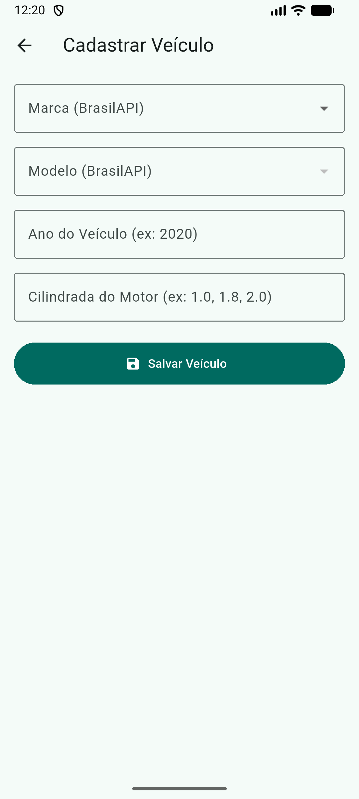
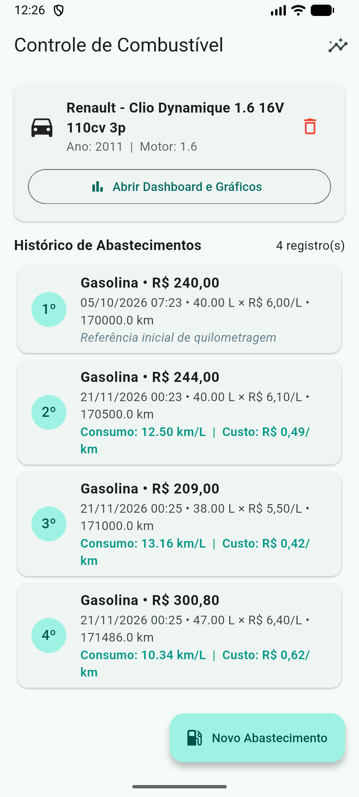
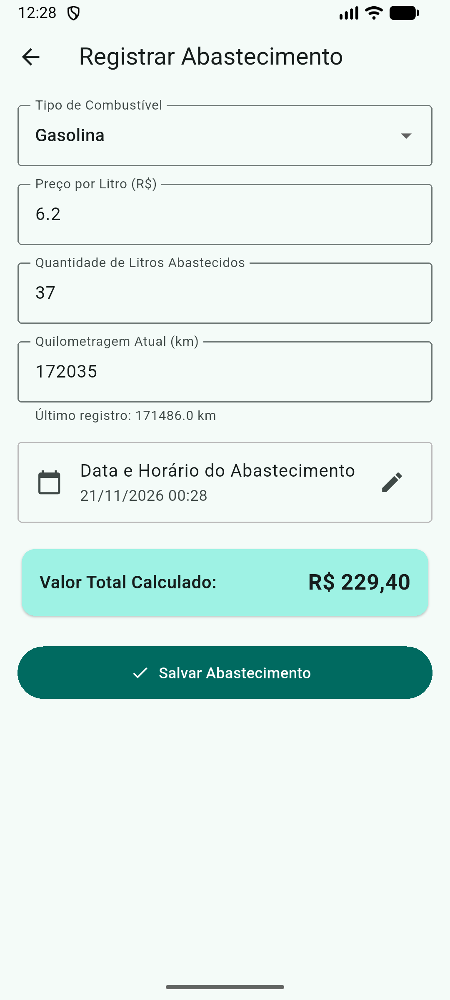
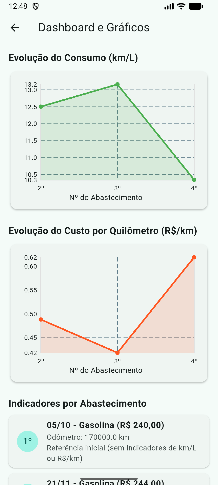

# Controle de Gastos com Combustível

Aplicativo desenvolvido em **Flutter** para a Atividade Substitutiva da Prova 1 da disciplina de **Programação para Dispositivos Móveis II** (Fatec - Prof. Arley).

## 📱 Descrição do Aplicativo
O aplicativo permite cadastrar um veículo consultando marcas e modelos diretamente na tabela FIPE via API pública, registrar os abastecimentos realizados ao longo do tempo e acompanhar indicadores financeiros e de eficiência energética (valor gasto, consumo em $km/L$ e custo por quilômetro em $R\$/km$) por meio de um dashboard interativo com gráficos de linha.

## 🚀 Instruções para Executar o Projeto

1. Clone este repositório:
   ```bash
   git clone <URL_DO_SEU_REPOSITORIO>
   cd controle_combustivel
   ```

2. Instale as dependências do projeto:
    ```bash
    git clone <URL_DO_SEU_REPOSITORIO>
    cd controle_combustivel
    ```
   
3. Execute o aplicativo (emulador Android, dispositivo físico ou Chrome):
    ```bash
    flutter run
    ```

## 🌐 API Utilizada e Bibliotecas Adotadas
- API Pública: BrasilAPI - Endpoints FIPE
  - Listagem de marcas: ```GET https://brasilapi.com.br/api/fipe/marcas/v1/carros```
  - Listagem de modelos por marca: ```GET https://brasilapi.com.br/api/fipe/veiculos/v1/carros/{codigoMarca}```

- Bibliotecas (pubspec.yaml):
  - [http]([`http`](https://pub.dev/packages/http)): Consumo da API REST da BrasilAPI.
  - [shared_preferences]([`shared_preferences`](https://pub.dev/packages/shared_preferences)): Persistência local dos dados do veículo e histórico de abastecimentos no dispositivo.
  - [fl_chart]([`fl_chart`](https://pub.dev/packages/fl_chart)): Renderização dos gráficos de linha de evolução do consumo (km/L) e do custo por quilômetro (R\$/km).
  - [intl]([`intl`](https://pub.dev/packages/intl)): Formatação de valores monetários (R\$) e datas (dd/MM/yyyy HH:mm).


## 📸 Capturas de Tela das Principais Funcionalidades
### Cadastro de Veículo (BrasilAPI):


### Tela Principal e Histórico de Abastecimentos:


### Registro de Abastecimento:


### Dashboard e Gráficos de Evolução:
